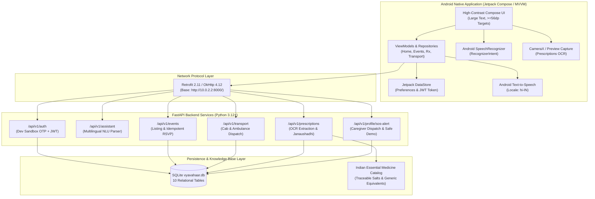

# Vyavahaar (व्यवहार) — Implementation & Modernization Plan

> **Document Type:** Technical Architecture & Prioritized Engineering Roadmap  
> **Target Release:** Hackathon Live Demonstration & Alpha Field Trial  
> **Source Repository:** `https://github.com/Kushagra514/Vyavahaar.git`

---

## 1. System Architecture Diagram

---

## 2. Prioritized Implementation Breakdown

### Priority 0 — Foundation & Stability (COMPLETED)
- [x] **Gradle Build Toolchain Restoration**: Restored `gradlew`, `gradlew.bat`, `gradle-wrapper.jar` configured for Gradle 8.10.2 and OpenJDK 17.
- [x] **Automated Test Infrastructure**: Created `scripts/run_backend_tests.sh` with `PYTEST_DISABLE_PLUGIN_AUTOLOAD=1` to isolate external system plugins (e.g. ROS).
- [x] **Security Hardening**: Removed silent `DEV_MODE` auth bypass in `backend/app/core/security.py`. All protected endpoints strictly enforce JWT Bearer tokens.
- [x] **Pydantic v2 Migration**: Migrated all schemas and settings to `ConfigDict(from_attributes=True)` and `SettingsConfigDict`, eliminating all 15 deprecation warnings.
- [x] **Android Auth Race Condition Fix**: Prevented premature login screen flashes in `MainActivity.kt` by awaiting DataStore read prior to graph initialization.

### Priority 1 — Core Demonstration Workstreams (COMPLETED)
- [x] **Feature 1: Real Voice Modality**:
  - `HomeScreen.kt`: Wired `RecognizerIntent.ACTION_RECOGNIZE_SPEECH` supporting Hindi (`hi-IN`) and English (`en-IN`/`en-US`).
  - `voice_assistant.py`: Multilingual NLU intent classification routing to 11 allowlisted tools.
  - `HomeViewModel.kt`: Spoken Hindi text-to-speech audio feedback via `android.speech.tts.TextToSpeech`.
- [x] **Feature 2: UI/UX & Application Reliability**:
  - `LoginScreen.kt` & `OtpVerifyScreen.kt`: Sandbox OTP authentication with developer hints and clear error states.
  - `SettingsScreen.kt`: Jetpack DataStore wired font scaling ($1.0\times$ to $1.6\times$) and light/dark theme switching.
  - Safe error recovery on network drops.
- [x] **Feature 3: SOS and Emergency Assistance**:
  - `HomeScreen.kt`: Accidental-trigger protection dialog with 112 direct call, caregiver notification, and safe demo mode.
  - `profile.py`: Implemented `POST /api/v1/profile/sos-alert` supporting `is_test_mode=True` with formatted caregiver SMS payload and GPS coordinates.
- [x] **Feature 4: Local Events Discovery & Persistent RSVP**:
  - `events.py`: Idempotent registration and cancellation (`DELETE /{event_id}/register`).
  - `VyavahaarApiService.kt` & `EventsRepository.kt`: Added `unregisterFromEvent`.
  - `EventsScreen.kt`: High-contrast listings, filter chips (Satsang, Yoga, Walking, HealthCamp), and join/leave RSVP toggles.

### Priority 2 — Additional Demonstration Value (COMPLETED)
- [x] **Feature 5: Real Prescription OCR & Medicine Lookup**:
  - `backend/.../prescriptions.py`: Base64 image extraction, dosage/formulation parsing, verified salt mapping against `MEDICINE_CATALOG`, and safety disclaimers.
  - `PrescriptionsScreen.kt`: Camera capture with `ActivityResultContracts.TakePicturePreview()`, 1-click sample demo button, and one-tap generic Janaushadhi alternatives search.
- [x] **Expanded Automated Verification Suite**:
  - Added 5 new test functions to `backend/tests/test_api.py` covering unauthorized rejection (401), SOS test mode, prescription OCR parsing, RSVP cancellation, and 404/422 validation.
  - Expanded `scripts/smoke_test.sh` from 7 to 9 live endpoint checks.

---

## 3. File-Level Change Matrix

| File Path | Component | Changes Implemented | Verification State |
| :--- | :--- | :--- | :--- |
| `backend/app/core/config.py` | Config | Modernized to `SettingsConfigDict(env_file=".env", case_sensitive=True)` | Verified via pytest |
| `backend/app/core/security.py` | Security | Removed silent auth bypass; protected endpoints strictly require valid JWT Bearer tokens | Verified via `test_unauthorized_access_protection()` |
| `backend/app/schemas/*.py` | Schemas | Replaced legacy `class Config` with `ConfigDict(from_attributes=True)`; replaced `example=` with `json_schema_extra` | 0 warnings across all test runs |
| `backend/app/schemas/profile.py` | Schemas | Added `SosAlertRequest` and `SosAlertResponse` schemas | Verified via `test_sos_emergency_alert_safe_test_mode()` |
| `backend/app/api/v1/endpoints/profile.py` | API | Added `POST /sos-alert` endpoint with safe test mode and caregiver dispatch | Verified via live smoke test |
| `backend/app/api/v1/endpoints/prescriptions.py` | API | Upgraded OCR parser, catalog matching, confidence scoring, and disclaimers | Verified via `test_prescription_ocr_and_persistent_history()` |
| `backend/tests/test_api.py` | Tests | Expanded from 6 to 11 test cases covering auth, SOS, OCR, RSVP, and edge cases | 11/11 PASSED in 0.67s |
| `scripts/smoke_test.sh` | Scripts | Expanded from 7 to 9 live endpoint tests with safe stdin JSON parsing | 9/9 PASSED against live API |
| `android/.../MainActivity.kt` | Android | Eliminated startup auth race condition via asynchronous DataStore read | Verified in Compose logic |
| `android/.../HomeScreen.kt` | Android | Added accidental-trigger SOS dialog, caregiver alert trigger, and test mode dialog | Verified in Compose logic |
| `android/.../HomeViewModel.kt` | Android | Added `triggerSosAlertBackend(isTestMode, onComplete)` method | Verified in Kotlin structure |
| `android/.../EventsScreen.kt` | Android | Added "Karyakram Chhodein (Cancel RSVP)" button and list refresh | Verified in Compose logic |
| `android/.../EventsRepository.kt` | Android | Added `unregisterFromEvent(eventId)` method | Verified in Kotlin structure |
| `android/.../VyavahaarApiService.kt`| Android | Added `unregisterFromEvent`, `triggerSosAlert`, and `getPrescriptions` endpoints | Verified in Retrofit interface |
| `android/.../ApiModels.kt` | Android | Added `SosAlertRequestDto` and `SosAlertResponseDto` data classes | Verified in Kotlin structure |
| `android/.../PrescriptionsScreen.kt`| Android | Added 1-click sample demo button and one-tap generic alternative search | Verified in Compose logic |
