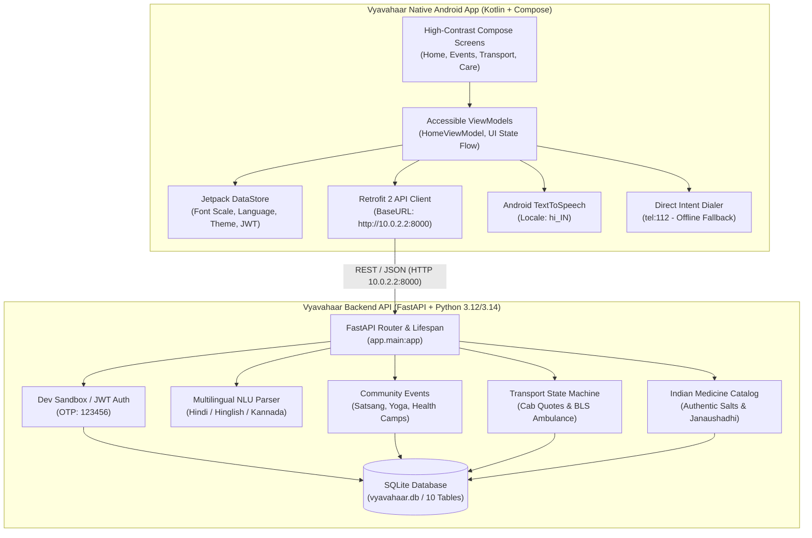

# Vyavahaar (व्यवहार)

> *“Aapke Vyavahar Mein Hi Humara Pyaar Hai”*  
> **India’s first voice-first social companion and elder care platform engineered specifically for senior citizens.**

---

## 1. Project Overview

**Vyavahaar** empowers Indian senior citizens to interact with modern mobile capabilities independently through natural spoken regional languages (Hindi, English, Kannada) without feeling intimidated by small text, confusing menus, complex passwords, or technical jargon.

### Target Users & Accessibility Goals
* **Target Audience**: Indian senior citizens ($60+$ years) who may have mild visual impairment, reduced motor dexterity, or hesitation with complex English-heavy mobile interfaces.
* **Large Touch Targets**: All interactive elements maintain touch targets $\ge 48\times 48\text{ dp}$ (typically $56\text{ dp}$ to $64\text{ dp}$).
* **Dynamic Accessibility Scaling**: Text scales dynamically from $1.0\times$ to $1.6\times$ without clipping or breaking layouts.
* **High Contrast & Warm Aesthetics**: Warm cream surface palette (`#F4F0EC`), high-contrast slate text (`#1C1B1F`), and prominent safety accents (SOS crimson `#BA1A1A`).
* **Deterministic Emergency Access**: Life-critical 112 emergency dialing triggers immediately via Android native telephony intents without blocking on cloud round-trips or network latency.

### Implemented vs. Planned Capabilities

| Capability | Current State in Repository | Implementation Location |
| :--- | :--- | :--- |
| **Direct 112 SOS Button** | **Implemented** | `android/.../home/HomeViewModel.kt` (Direct `ACTION_DIAL` intent) |
| **Multilingual Voice NLU** | **Implemented** | `backend/app/services/voice_assistant.py` (Local regex & entity parser) |
| **Indian Medicine Catalog** | **Implemented** | `backend/app/services/medicine_catalog.py` (Authentic salt & generic catalog) |
| **Community Events & RSVP** | **Implemented** | `backend/app/api/v1/endpoints/events.py` (Idempotent registration) |
| **Transport State Machine** | **Implemented** | `backend/app/api/v1/endpoints/transport.py` (Cab quotation & ambulance dispatch) |
| **Doctor Appointments** | **Implemented** | `backend/app/api/v1/endpoints/appointments.py` (One-time and monthly visits) |
| **Sandbox OTP Authentication** | **Implemented** | `backend/app/api/v1/endpoints/auth.py` (Fixed dev code `123456`) |
| **Native Hindi/English TTS** | **Implemented** | `android/.../home/HomeViewModel.kt` (Android `TextToSpeech` engine) |
| **Senior Compose Screens** | **Implemented** | `android/.../ui/screens/` (Home, Auth, Events, Transport, Prescriptions, etc.) |
| **Live Android Audio Capture** | **Implemented** | `android/.../home/HomeScreen.kt` (Android `SpeechRecognizer` Intent with Hindi/English) |
| **Prescription Camera Capture** | **Implemented** | `android/.../prescriptions/PrescriptionsScreen.kt` (Camera capture with Base64 JPEG) |
| **Continuous Integration (CI)**| **Implemented** | `.github/workflows/ci.yml` (Automated backend tests, smoke tests, and Gradle checks) |
| **Cloud Speech / LLM API** | **Planned / Optional**| Google Cloud Speech & Gemini 1.5 Flash hooks in backend config |

### High-Level System Architecture



---

## 2. Technology Stack

### Actually Present in Repository
* **Android Client**:
  * **Language & Runtime**: Kotlin `2.0.21`, Android Gradle Plugin `8.7.1`
  * **UI Toolkit**: Jetpack Compose with Material 3 (`androidx.compose.material3`)
  * **Architecture**: MVVM with Unidirectional Data Flow (`StateFlow`, `AndroidViewModel`)
  * **Networking**: Retrofit `2.11.0` + OkHttp `4.12.0` with Gson converter
  * **Preferences**: Jetpack DataStore Preferences `1.1.1`
  * **Accessibility & Audio**: Android Native `TextToSpeech` (`hi_IN`), Telephony Intent Dialer
  * **Build System**: Gradle `8.10.2` with Version Catalog (`gradle/libs.versions.toml`)
* **Backend API**:
  * **Framework**: FastAPI `>=0.115.0`, Uvicorn `>=0.32.0`, Starlette
  * **Language**: Python `3.10+` (tested on Python `3.12` and `3.14`)
  * **Data Validation**: Pydantic `v2.9.0` & `pydantic-settings`
  * **Database & ORM**: SQLAlchemy `2.0.35` with SQLite (development)
  * **Authentication**: Python-JOSE (JWT Bearer tokens), Passlib (Bcrypt)
  * **Testing**: Pytest `8.3.3`, Pytest-Asyncio `0.24.0`, HTTPX `0.27.2`
* **Containerization & Tooling**:
  * Dockerfile (Python 3.12 slim), Docker Compose `v2+`, automated test runner scripts

### Planned Technologies (Not Yet Integrated)
* **Real Cloud STT**: Google Cloud Speech-to-Text / Bhashini API
* **Cloud LLM**: Google Gemini 1.5 Flash (placeholder setting exists in `config.py`)
* **Camera Capture**: Android Jetpack CameraX (currently uses sample payload)
* **Production Database**: PostgreSQL with Alembic migrations

---

## 3. Prerequisites

| Component | Minimum Version | Derivation / Config File | Installation Link / Notes |
| :--- | :--- | :--- | :--- |
| **Git** | `2.30+` | Version control | `sudo apt install git` / [git-scm.com](https://git-scm.com/) |
| **Python** | `3.10+` (3.12 recommended) | `backend/requirements.txt` | `sudo apt install python3 python3-venv python3-pip` |
| **Java JDK** | **JDK 17** | `android/app/build.gradle.kts#L34-L39` | `sudo apt install openjdk-17-jdk` (*See note below*) |
| **Android Studio** | Koala / Ladybug (2024.1+) | Gradle version catalog | [developer.android.com/studio](https://developer.android.com/studio) |
| **Android SDK** | Compile SDK **35**, Min SDK **26** | `android/app/build.gradle.kts#L8-L14` | Installed via Android Studio SDK Manager |
| **Docker** (Optional) | `24.0+` with Compose | `docker-compose.yml` | `sudo apt install docker.io docker-compose-v2` |

> [!IMPORTANT]
> **JDK Version Requirement**: The Android project explicitly targets **Java 17** (`JavaVersion.VERSION_17`, `jvmTarget = "17"`). Do not run Gradle with JDK 25 or bleeding-edge early-access JDKs, as Gradle's Kotlin DSL compiler will throw `java.lang.IllegalArgumentException: 25.0.4.1`. Install OpenJDK 17 and configure `JAVA_HOME=/usr/lib/jvm/java-17-openjdk-amd64`.

---

## 4. Clone & Directory Navigation

Clone the repository and inspect the folder structure:

```bash
git clone https://github.com/your-org/Vyavahaar.git
cd Vyavahaar
```

Expected directory tree:
```
Vyavahaar/
├── android/          # Native Android Studio project
├── backend/          # FastAPI Python application
├── scripts/          # Helper scripts (run_backend_tests.sh, smoke_test.sh)
├── docker-compose.yml# Container orchestration
├── PROJECT_STATUS.md # Live verification progress tracker
└── README.md         # Documentation
```

---

## 5. Environment Variables & Secrets

All backend environment settings are loaded via `pydantic-settings` from a local `.env` file in `backend/.env`.

### Environment Variables Reference

| Variable Name | Required | Default in Dev | Purpose |
| :--- | :--- | :--- | :--- |
| `PROJECT_NAME` | No | `"Vyavahaar API"` | Human-readable title in OpenAPI docs |
| `API_V1_STR` | No | `"/api/v1"` | URL prefix for version 1 API endpoints |
| `SECRET_KEY` | **Yes (Prod)** | `"vyavahaar-senior-..."` | Cryptographic secret for signing JWT tokens |
| `ACCESS_TOKEN_EXPIRE_MINUTES` | No | `43200` (30 days) | Session duration before elder re-login |
| `DATABASE_URL` | No | `"sqlite:///./vyavahaar.db"` | SQLAlchemy database URI (`postgresql://...` for prod) |
| `DEV_MODE` | No | `True` | Enables sandbox OTP bypass without sending live SMS |
| `DEV_TEST_PHONE` | No | `"+919876543210"` | Allowed development test phone number |
| `DEV_TEST_OTP` | No | `"123456"` | Deterministic development verification OTP |
| `GEMINI_API_KEY` | Optional | `""` | Optional Google Gemini key for future AI features |
| `FIREBASE_PROJECT_ID` | Optional | `""` | Optional Firebase project ID for SMS authentication |

### Setting Up Local Environment

Copy the provided example file:
```bash
cd backend
cp .env.example .env
```

> [!WARNING]
> Never commit `.env`, private keys (`*.pem`), or `service-account*.json` into Git. These are safely ignored by the root `.gitignore`.

---

## 6. Launch the Backend

### Step-by-Step Procedure

1. **Open a terminal** and navigate to the backend directory:
   ```bash
   cd backend
   ```
2. **Create and activate a virtual environment**:
   ```bash
   python3 -m venv venv
   source venv/bin/activate
   ```
3. **Install dependencies**:
   ```bash
   pip install -r requirements.txt
   ```
4. **Initialize the database** (creates tables and seeds sample community events):
   ```bash
   python app/db_init.py
   ```
   *Expected output*: `Database initialized and seeded successfully.`
5. **Run automated test suite**:
   ```bash
   ../scripts/run_backend_tests.sh
   ```
   *Expected output*: `6 passed in 0.93s`
6. **Start the development server**:
   ```bash
   uvicorn app.main:app --host 0.0.0.0 --port 8000 --reload
   ```
7. **Verify that the backend is running**:
   * Health Check: [http://127.0.0.1:8000/health](http://127.0.0.1:8000/health)  
     `{"status":"healthy","service":"Vyavahaar API","version":"1.0.0",...}`
   * Interactive Swagger UI: [http://127.0.0.1:8000/docs](http://127.0.0.1:8000/docs)
   * Web Companion Preview: [http://127.0.0.1:8000/](http://127.0.0.1:8000/)

### Alternative: Launch via Docker Compose
To run the backend inside a reproducible container:
```bash
docker compose up -d --build
```
Inspect logs with `docker compose logs -f backend`.

---

## 7. Launch the Android Application

### Workflow 1: Android Studio (Recommended)

1. Launch Android Studio.
2. Select **Open** and select the `/path/to/Vyavahaar/android` folder.
3. Allow Gradle to synchronize dependencies.
4. **Configure JDK**: Go to `File` $\to$ `Settings` (or `Preferences` on macOS) $\to$ `Build, Execution, Deployment` $\to$ `Build Tools` $\to$ `Gradle` $\to$ Set **Gradle JDK** to **Embedded JDK 17** or **OpenJDK 17**.
5. **Create / Launch Emulator**:
   * Open Device Manager (`Tools` $\to$ `Device Manager`).
   * Create an Android Virtual Device with **API 34 or 35** (e.g. Pixel 8 / 9 with Play Services).
   * Start the emulator.
6. **Run the App**: Select the `app` configuration in the top toolbar and click the green **Run ▶** button.

### Workflow 2: Command Line (CLI)

```bash
cd android
# Ensure JAVA_HOME points to JDK 17
export JAVA_HOME=/usr/lib/jvm/java-17-openjdk-amd64

# Check available Gradle tasks
./gradlew tasks

# Run unit tests
./gradlew testDebugUnitTest

# Build debug APK
./gradlew assembleDebug

# Install on a running emulator or connected device
./gradlew installDebug
```

### Emulator Networking & Base URL
* **Android Emulator**: In `android/.../ApiClient.kt`, `baseUrl` defaults to `http://10.0.2.2:8000/`. Inside the standard Android emulator, `10.0.2.2` automatically routes to `127.0.0.1` on your development computer.
* **Physical Device**: Connect phone to the same Wi-Fi network as your computer, find your computer's local IP (e.g. `192.168.1.15`), and update `ApiClient.baseUrl = "http://192.168.1.15:8000/"`.
* **Cleartext Traffic**: The debug application enables `android:usesCleartextTraffic="true"` in `AndroidManifest.xml` so development over local HTTP works smoothly without custom TLS certificates.

---

## 8. Complete End-to-End Startup Order

To run and test the complete Vyavahaar system:

1. **Start Backend**:
   ```bash
   cd backend
   source venv/bin/activate
   uvicorn app.main:app --host 0.0.0.0 --port 8000
   ```
2. **Execute Live Smoke Test** (validates backend health, auth, NLU, and database):
   ```bash
   ./scripts/smoke_test.sh
   ```
3. **Launch Android Emulator & Application**:
   * Open `android/` in Android Studio and press **Run**.
4. **Sign In**:
   * Mobile Number: `+91 9876543210` (or any 10-digit number in dev mode)
   * Verification Code: `123456`
5. **Verify Primary User Flows**:
   * Tap the **Red SOS Button** $\to$ Confirms direct dialing intent to 112.
   * Tap the **Calendar Icon** $\to$ Confirms community satsangs and morning walk registrations.
   * Tap the **Care Icon (+)** $\to$ Initiates transport / ambulance request.
   * Tap the **Settings Gear** $\to$ Adjust font scale slider and observe dynamic UI scaling.

---

## 9. Development Test Accounts & Seed Data

In development mode (`DEV_MODE=True`), external SMS gateway charges are bypassed:
* **Test Phone Number**: `+91 9876543210` (any 10-digit number accepted)
* **Sandbox OTP Code**: `123456`
* **Pre-seeded Events**: 4 verified community gatherings (Ram Mandir Satsang, Cubbon Park Laughter Yoga, Online Pranayama, Sanjaynagar BP/Sugar Health Camp).
* **Pre-seeded Trusted Contacts**: Beta (Rahul), Beti (Priya), Dr. Sharma, Sharma Ji (Neighbor).

---

## 10. API Documentation (Endpoints Actually Implemented)

All API endpoints are prefixed with `/api/v1` (except `/health` and `/docs`).

### A. Authentication
* **`POST /api/v1/auth/request-otp`**  
  *Request*: `{"phone_number": "+919876543210"}`  
  *Response (200)*: `{"message": "Aapke phone number par OTP bhej diya gaya hai.", "phone_number": "+919876543210", "cooldown_seconds": 60, "dev_otp": "123456"}`
* **`POST /api/v1/auth/verify-otp`**  
  *Request*: `{"phone_number": "+919876543210", "otp_code": "123456"}`  
  *Response (200)*: `{"access_token": "eyJhbGci...", "token_type": "bearer", "user_id": 1, "is_onboarded": true, "phone_number": "+919876543210"}`  
  *Errors*: `400 Bad Request` if OTP code is invalid or expired.

### B. User Profile & Emergency Contacts
* **`GET /api/v1/profile/`** (Auth required)  
  *Response (200)*: `{"id": 1, "phone_number": "+919876543210", "name": "Aadarniya Sadasya", "preferred_language": "hi", "font_scale": 1.2, "emergency_contacts": [...]}`
* **`PATCH /api/v1/profile/`** (Auth required)  
  *Request*: `{"name": "Aadarniya Dadaji", "preferred_language": "hi", "font_scale": 1.4}`
* **`POST /api/v1/profile/emergency-contacts`** (Auth required)  
  *Request*: `{"name": "Beti Sunita", "phone_number": "+919876543299", "relationship_type": "Daughter", "is_primary": true, "can_view_location": true}`
* **`DELETE /api/v1/profile/emergency-contacts/{contact_id}`** (Auth required)

### C. Voice Assistant & Intent Routing
* **`POST /api/v1/assistant/process-command`** (Auth required)  
  *Request*: `{"transcript": "Bachao, emergency hai, 112 ko call lagao", "detected_language": "hi"}`  
  *Response (200)*:
  ```json
  {
    "recognized_text": "Bachao, emergency hai, 112 ko call lagao",
    "spoken_feedback": "Aapka SOS alert khola ja raha hai. Direct 112 call aur parivar ko sandesh taiyaar hai.",
    "intent": "send_sos_alert",
    "confidence": 0.99,
    "tool_call": {
      "tool_name": "send_sos_alert",
      "parameters": {"emergency_type": "GENERAL_SOS", "trigger_112": true},
      "requires_confirmation": false
    }
  }
  ```
* **`GET /api/v1/assistant/supported-tools`**: Returns the list of 11 allowlisted tools.

### D. Community Events
* **`GET /api/v1/events/?category=Satsang`** (Auth required): Returns verified community gatherings.
* **`POST /api/v1/events/{event_id}/register`** (Auth required): Idempotent registration for an event.
* **`DELETE /api/v1/events/{event_id}/register`** (Auth required): Cancels registration.

### E. Transport & Mobility
* **`POST /api/v1/transport/request`** (Auth required)  
  *Request*: `{"request_type": "CAB", "pickup_address": "Indiranagar", "destination_address": "Mandir"}`  
  *Response (200)*: Status `QUOTED`, fare estimate `149.0`. For `AMBULANCE`, status is `CONFIRMED` with emergency direct call number `112`.
* **`POST /api/v1/transport/{transport_id}/confirm`** (Auth required): Confirms cab and assigns driver.
* **`POST /api/v1/transport/{transport_id}/cancel`** (Auth required): Cancels ride request.

### F. Doctor Appointments & Medicine Catalog
* **`GET /api/v1/appointments/`** (Auth required): Returns upcoming visits.
* **`POST /api/v1/appointments/`** (Auth required): Schedules visit (`recurrence_rule`: `ONCE`, `WEEKLY`, `MONTHLY`).
* **`GET /api/v1/prescriptions/medicines/search?q=Metformin`**  
  *Response (200)*: Returns salt `Metformin Hydrochloride`, verified brand equivalents (Glycomet, Glyciphage), Janaushadhi low-cost alternatives, and clinical safety disclaimers.
* **`POST /api/v1/prescriptions/scan`** (Auth required): Simulated prescription OCR parsing.

### G. Contacts & Messaging
* **`GET /api/v1/contacts/`** (Auth required): Returns senior's trusted contacts list.
* **`GET /api/v1/contacts/messages`** (Auth required): Returns conversation history.

---

## 11. Voice AI Architecture & Design Specifications

### 1. Intent Engine & Deterministic Safety
* **Current Implementation**: Multilingual regex and entity extractor in `backend/app/services/voice_assistant.py`.
* **Latency & Cost**: Deterministic sub-millisecond execution ($<10\text{ ms}$) on local CPU with zero API costs and 100% offline development reliability.
* **Safety Rules**: Voice commands can **only** trigger allowlisted tools. Consequential actions (e.g. cab booking) require explicit verbal or UI confirmation (`requires_confirmation=True`).
* **Emergency Override**: SOS or 112 phrases immediately bypass confirmations and trigger direct dialing.

### 2. Supported Test Utterances

Senior citizens can speak in Hindi, English, or Hinglish:
* **SOS Emergency**: *“Bachao, emergency hai, 112 ko call lagao”* $\to$ Dispatches SOS tool & 112 intent.
* **Satsang Discovery**: *“Mujhe aaj ke satsang dikhao”* $\to$ Filters events by `Satsang`.
* **Cab Booking**: *“Mere liye mandir ke liye ek cab book karo”* $\to$ Quotes cab with confirmation dialog.
* **Ambulance**: *“Ambulance chahiye, tabiyat kharab hai”* $\to$ Dispatches medical transport & offers 112 call.
* **Family Calling**: *“Mujhe apne bete ko call karni hai”* $\to$ Routes call to registered contact `Beta`.
* **Accessibility**: *“Text size bada kar do”* $\to$ Dynamically scales font size to $1.4\times$.
* **Language Switch**: *“English mein baat karo”* or *“Hindi mein baat karo”* $\to$ Updates preferred language.
* **Cancellation**: *“Cancel karo”* or *“Wapas jao”* $\to$ Safely dismisses active tool and returns Home.

---

## 12. Troubleshooting Guide

### 1. Gradle Failure: `java.lang.IllegalArgumentException: 25.0.4.1`
* **Cause**: Your system or IDE is using JDK 25. Gradle 8.10's Kotlin DSL parser does not support JDK 25.
* **Fix**: Install OpenJDK 17 (`sudo apt install openjdk-17-jdk`) and set:
  ```bash
  export JAVA_HOME=/usr/lib/jvm/java-17-openjdk-amd64
  ```
  In Android Studio, select JDK 17 under Gradle settings.

### 2. Pytest Failure: `ModuleNotFoundError: No module named 'osrf_pycommon'`
* **Cause**: On Ubuntu machines with ROS (Robot Operating System) installed, pytest automatically discovers broken ROS test plugins.
* **Fix**: Run backend tests using the provided script, which isolates plugins:
  ```bash
  ./scripts/run_backend_tests.sh
  ```

### 3. Backend Port 8000 Already in Use (`[Errno 98]`)
* **Cause**: Another Uvicorn instance is already bound to port 8000.
* **Fix**: Check running processes:
  ```bash
  ss -tulpn | grep 8000
  # Terminate the existing process if desired
  kill <PID>
  ```

### 4. Android Emulator Cannot Reach Backend (`Connection Refused`)
* **Cause**: The app is trying to connect to `localhost:8000`. Inside an Android emulator, `localhost` is the emulator itself!
* **Fix**: Use `http://10.0.2.2:8000/`. Verify that `ApiClient.baseUrl` in `android/.../ApiClient.kt` is set to `http://10.0.2.2:8000/`.

### 5. Cleartext HTTP Traffic Blocked
* **Cause**: Android 9+ blocks unencrypted HTTP traffic by default.
* **Fix**: The debug manifest in `android/app/src/main/AndroidManifest.xml` already sets `android:usesCleartextTraffic="true"`. Do not remove this attribute during local development.

---

## 13. Team Workflow & References

* **Project Progress Tracker**: See [PROJECT_STATUS.md](PROJECT_STATUS.md) for live verification state and assigned owners.
* **Team Guidelines**: See [CONTRIBUTING.md](CONTRIBUTING.md) for branch naming, coding style, and PR requirements.
